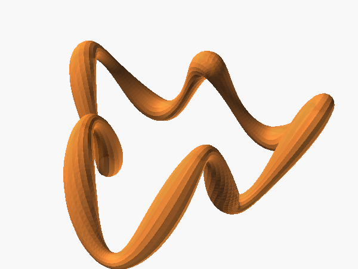
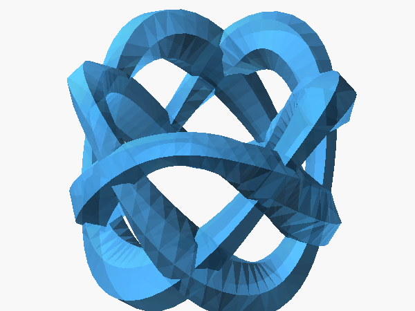
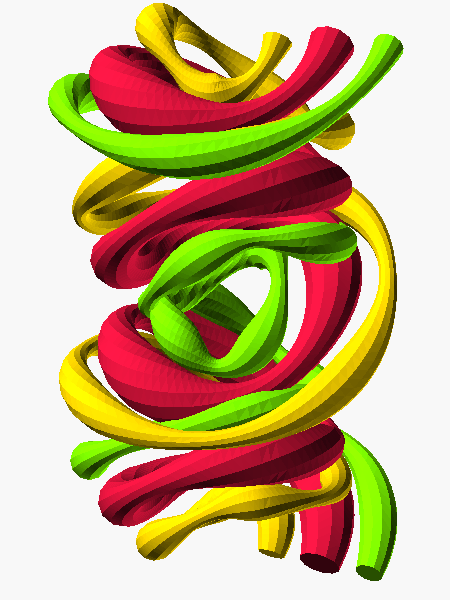
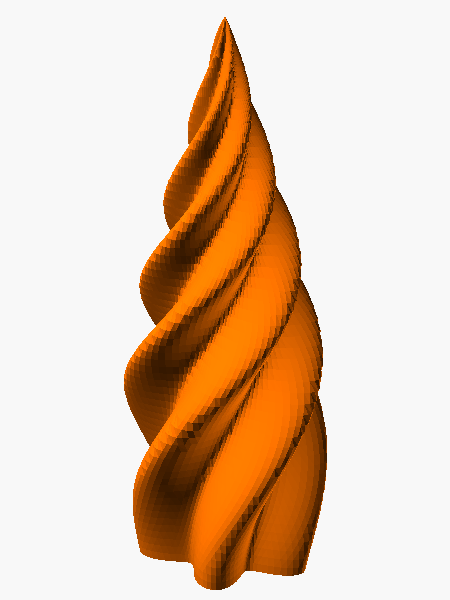

# scadsculpt

Generative sculptures in OpenSCAD. Each is one file with its parameters in the Customizer, built as
a single polyhedron (or three, for the gargoyle) from closed-form curves, and set on the bed.

| | |
| --- | --- |
|  |  |
| `chiral_sonic_bloom.scad`: a pulsing tube swept round a wavy ring, with a twist | `crystal_helix_knot.scad`: a faceted tube tied in a Lissajous knot |
|  |  |
| `hyper_gargoyle.scad`: a rising spiral spine with two vines wound round it | `flame_plumes.scad`: tongues of flame twisting faster towards a point |

## Use it

Open a file in [OpenSCAD](https://openscad.org) and change its parameters in the Customizer. Each
sculpture sits with its lowest point on z = 0. The tube sculptures touch the bed at only a few
points, so they print with supports, or resin.

## Checks

`just test` takes about 2 s on OpenSCAD 2026.10.15. It renders each sculpture with warnings
treated as errors and checks that it's one solid with its faces pointing outward (a positive
volume), sitting on z = 0, at the size it has always had; and that the flame refuses impossible
input.

`just images` renders the pictures above.

## Origin and licence

`flame_plumes.scad` was first modified from the flame sculpture in Jochen Kerdels'
[Mastering OpenSCAD](https://mastering-openscad.eu/buch/example_07/), which states no licence. It
is now new code with a different method, a lobed cross-section that twists and narrows, and only
the idea comes from the book. The earlier version is in this repository's history.

MIT; see [LICENSE](LICENSE).
